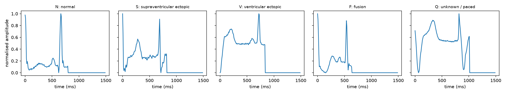
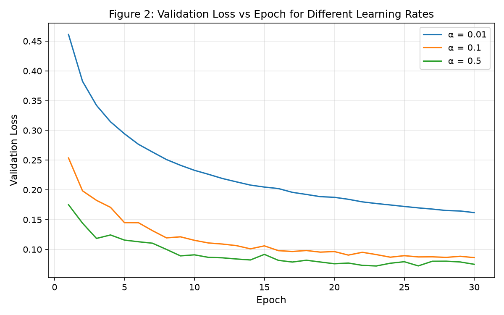
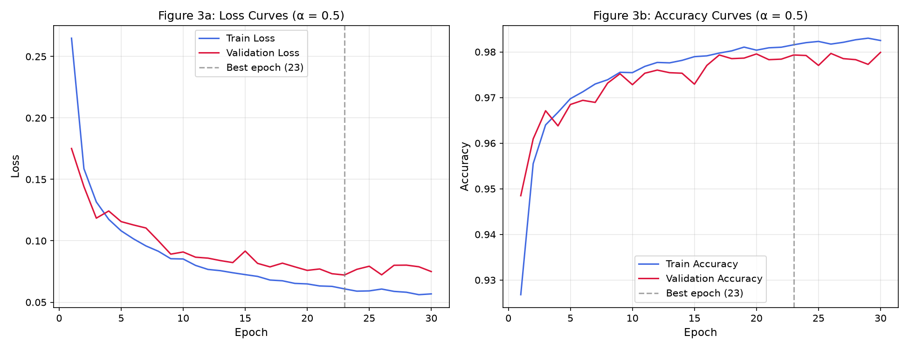
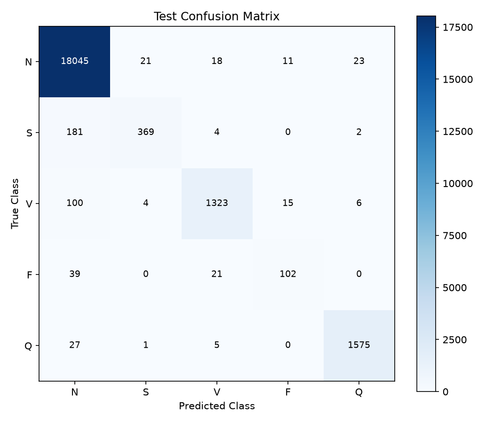
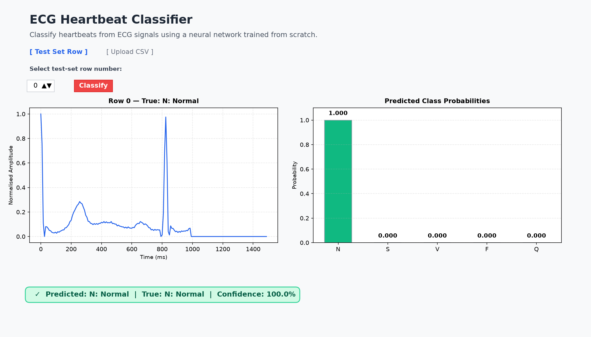

# Classifying Heartbeats from ECG Signals
### A Deep Neural Network Built & Trained From Scratch in PyTorch

[](https://www.python.org/)
[](https://pytorch.org/)
[]()
[]()
[]()
[-critical.svg)]()
[](https://www.zainabbas.me/)

---

## Table of Contents

1. [Executive Summary & Problem Statement](#1-executive-summary--problem-statement)
2. [The Core Question: Accuracy vs Balanced Accuracy](#2-the-core-question-accuracy-vs-balanced-accuracy)
3. [Mathematical Foundations & Derivations](#3-mathematical-foundations--derivations)
   - [3.1 Network Topology & Forward Propagation](#31-network-topology--forward-propagation)
   - [3.2 Parameter Count Derivation](#32-parameter-count-derivation)
   - [3.3 He (Kaiming) Weight Initialisation](#33-he-kaiming-weight-initialisation)
   - [3.4 Numerically Stable Softmax Cross-Entropy](#34-numerically-stable-softmax-cross-entropy)
   - [3.5 Analytical Backpropagation Gradient Verification](#35-analytical-backpropagation-gradient-verification)
   - [3.6 Custom Optimiser: Mini-Batch SGD with Momentum & Weight Decay](#36-custom-optimiser-mini-batch-sgd-with-momentum--weight-decay)
4. [Strict Library Compliance Audit](#4-strict-library-compliance-audit)
5. [Dataset & Reproducible Split Protocol](#5-dataset--reproducible-split-protocol)
6. [Repository Structure](#6-repository-structure)
7. [Step-by-Step Reproduction Guide](#7-step-by-step-reproduction-guide)
8. [Experimental Results & Tables](#8-experimental-results--tables)
   - [Table 1: Data Summary](#table-1--data-summary)
   - [Table 2: Network & Training Specifications](#table-2--network--training-specifications)
   - [Table 3: Learning Rate Sweep (α Selection)](#table-3--learning-rate-sweep-α-selection)
   - [Table 4: Test Evaluation & Per-Class Breakdown](#table-4--test-evaluation--per-class-breakdown)
   - [Test Confusion Matrix (5×5)](#test-confusion-matrix-55)
9. [Figures & Visualizations Gallery](#9-figures--visualizations-gallery)
10. [Task 6: Comprehensive Analytical Inquiries](#10-task-6-comprehensive-analytical-inquiries)
11. [Interactive Web Applications](#11-interactive-web-applications)
    - [11.1 Standalone Browser App (HTML/JS/Canvas - zainabbas.me Style)](#111-standalone-browser-app-htmljscanvas---zainabbasme-style)
    - [11.2 Streamlit Web Application](#112-streamlit-web-application)
12. [Deliverables: Blog, Post & Viva Preparation](#12-deliverables-blog-post--viva-preparation)

---

## 1. Executive Summary & Problem Statement

An **electrocardiogram (ECG)** records the millivolt-scale electrical potentials generated by cardiac muscle depolarisation and repolarisation over time. In a healthy heart, each beat exhibits a structured P-QRS-T sequence. However, structural damage, ischemia, or aberrant conduction pathways induce cardiac arrhythmias—abnormal rhythms that impair hemodynamic performance and can precipitate sudden cardiac death.

```
       R (Ventricular Depolarisation)
       /\
      /  \
 P   /    \       T (Ventricular Repolarisation)
/\  /      \     /\
--\/--------\---/--\------ Baseline (Isoelectric)
  Q          S
```

### Input & Output Formalism
- **Input ($x$):** A single segmented heartbeat represented as a normalized 1D vector of $187$ temporal voltage samples sampled at $f_s = 125\text{ Hz}$ ($\sim 1.5$ seconds duration).
- **Output ($y$):** Categorisation into one of 5 AAMI standard cardiac classes:
  1. **N (Normal):** Sinoatrial rhythm, bundle branch blocks.
  2. **S (Supraventricular Ectopic):** Atrial premature or junctional premature contractions.
  3. **V (Ventricular Ectopic):** Premature ventricular contractions (PVCs).
  4. **F (Fusion Beat):** Hybrid activation from concurrent normal and ventricular ectopic sites.
  5. **Q (Unknown / Paced):** Artificial pacemaker spikes or unclassifiable waveforms.

---

## 2. The Core Question: Accuracy vs Balanced Accuracy

> **"How well does a small neural network recognise each type of heartbeat, and is overall accuracy the right number to trust when one class is far more common than the others?"**

In the test set of $21,892$ heartbeats:
- **Class N:** $18,118$ beats ($82.76\%$)
- **Class S:** $556$ beats ($2.54\%$)
- **Class V:** $1,448$ beats ($6.61\%$)
- **Class F:** $162$ beats ($0.74\%$)
- **Class Q:** $1,608$ beats ($7.35\%$)

### The Fallacy of Majority-Class Accuracy
A trivial "Always-N" baseline classifier that simply predicts Class N for every sample without inspecting the ECG signal scores:
$$\text{Accuracy}_{\text{Always-N}} = \frac{18,118}{21,892} = \mathbf{82.76\%}$$

In an intensive care telemetry ward, an "Always-N" monitor would miss **$100\%$ of ventricular ectopic beats (arrhythmias preceding ventricular fibrillation) and 100% of supraventricular events**, while masquerading as an "83% accurate" diagnostic tool.

To expose the true clinical capability across all classes, we evaluate both **Overall Accuracy** and **Balanced Accuracy**:
$$\text{Accuracy} = \frac{1}{m} \sum_{i=1}^m \mathbf{1}[\hat{y}^{(i)} = y^{(i)}], \qquad \text{Balanced Accuracy} = \frac{1}{5} \sum_{c=0}^4 \text{Accuracy}_c$$

Our trained model reaches **97.82% overall accuracy** and **83.65% balanced accuracy**, demonstrating true arrhythmia discrimination well beyond the majority class.

---

## 3. Mathematical Foundations & Derivations

### 3.1 Network Topology & Forward Propagation

The architecture consists of a 3-layer fully connected Multi-Layer Perceptron (MLP) built from raw tensor parameters:

| Layer ($\ell$) | Input Dim ($n^{[\ell-1]}$) | Output Dim ($n^{[\ell]}$) | Activation Function | Parameter Shapes |
|:---:|:---:|:---:|:---:|:---:|
| **Layer 1** | $187$ | $128$ | Custom $\text{ReLU}(z) = \max(0, z)$ | $W^{[1]} \in \mathbb{R}^{128 \times 187}, \; b^{[1]} \in \mathbb{R}^{128}$ |
| **Layer 2** | $128$ | $64$ | Custom $\text{ReLU}(z) = \max(0, z)$ | $W^{[2]} \in \mathbb{R}^{64 \times 128}, \; b^{[2]} \in \mathbb{R}^{64}$ |
| **Layer 3** | $64$ | $5$ | Linear Logits (Softmax in Loss) | $W^{[3]} \in \mathbb{R}^{5 \times 64}, \; b^{[3]} \in \mathbb{R}^{5}$ |

For a mini-batch matrix $X \in \mathbb{R}^{B \times 187}$ with individual row vectors $x^{(i)} \in \mathbb{R}^{187}$:
$$\begin{aligned}
Z^{[1]} &= X W^{[1]\top} + \mathbf{1}_B b^{[1]\top} \in \mathbb{R}^{B \times 128}, \quad &&A^{[1]} = \text{clamp}(Z^{[1]}, \min=0) \\
Z^{[2]} &= A^{[1]} W^{[2]\top} + \mathbf{1}_B b^{[2]\top} \in \mathbb{R}^{B \times 64}, \quad &&A^{[2]} = \text{clamp}(Z^{[2]}, \min=0) \\
Z^{[3]} &= A^{[2]} W^{[3]\top} + \mathbf{1}_B b^{[3]\top} \in \mathbb{R}^{B \times 5}
\end{aligned}$$

---

### 3.2 Parameter Count Derivation

Every weight matrix and bias vector is registered as an explicit `nn.Parameter`:

$$\begin{aligned}
\text{Layer 1 Params} &= n^{[1]} \times n^{[0]} + n^{[1]} = 128 \times 187 + 128 = 23,936 + 128 = \mathbf{24,064} \\
\text{Layer 2 Params} &= n^{[2]} \times n^{[1]} + n^{[2]} = 64 \times 128 + 64 = 8,192 + 64 = \mathbf{8,256} \\
\text{Layer 3 Params} &= n^{[3]} \times n^{[2]} + n^{[3]} = 5 \times 64 + 5 = 320 + 5 = \mathbf{325} \\
\mathbf{\text{Total Trainable Parameters}} &= 24,064 + 8,256 + 325 = \mathbf{32,645}
\end{aligned}$$

---

### 3.3 He (Kaiming) Weight Initialisation

Weights are initialized independently from a Gaussian distribution with zero mean and variance tailored to ReLU:
$$W^{[\ell]}_{ij} \sim \mathcal{N}\left(0, \, \sqrt{\frac{2}{n^{[\ell-1]}}}\right), \qquad b^{[\ell]} = \mathbf{0}$$

#### Theoretical Justification:
1. **Symmetry Breaking:** If all weights are initialized to zero ($W = \mathbf{0}$), every hidden unit computes $z_j = 0$, producing identical activations and identical backpropagated gradients. The hidden layer acts as a single scalar neuron throughout training.
2. **ReLU Variance Compensation:** Linear activations maintain signal variance with Xavier initialisation ($\sigma^2 = 1/n_{\text{in}}$). However, ReLU zeroes out all negative activations ($\sim 50\%$ of the signal), halving the variance:
   $$\text{Var}(A^{[\ell]}) \approx \frac{1}{2} \text{Var}(Z^{[\ell]})$$
   He initialisation compensates for this 50% drop by multiplying the variance by $2$ ($\sigma^2 = 2/n_{\text{in}}$), preserving constant activation variance across forward layers and preventing gradient vanishing or explosion.

---

### 3.4 Numerically Stable Softmax Cross-Entropy

For logit vector $z \in \mathbb{R}^5$ and true class index $y \in \{0, \dots, 4\}$:
$$P(y = k \mid z) = \frac{e^{z_k}}{\sum_{j=0}^4 e^{z_j}}$$
The sample negative log-likelihood loss is:
$$L = -\log P(y \mid z) = -z_y + \log \left(\sum_{j=0}^4 e^{z_j}\right)$$

#### Numerical Stability via LogSumExp:
Computing $\sum e^{z_j}$ directly can result in arithmetic overflow (inf) if $z_j > 88$ in 32-bit floating point. We rewrite this via `torch.logsumexp`:
$$\log \left(\sum_{j=0}^4 e^{z_j}\right) = c + \log \left(\sum_{j=0}^4 e^{z_j - c}\right), \quad \text{where } c = \max_j(z_j)$$
Over a batch of size $B$:
$$J = \frac{1}{B} \sum_{i=1}^B \left[-Z^{[3]}_{i, y^{(i)}} + \text{logsumexp}(Z^{[3]}_{i, :})\right]$$

**Initial Loss Sanity Check:** At initialization with random weights and zero bias, all classes are equiprobable ($P \approx 1/5 = 0.2$):
$$\mathbb{E}[J_{\text{init}}] \approx -\log(0.2) = \log(5) \approx \mathbf{1.6094}$$
Our empirical initial loss before training was **$1.7413$**, matching theoretical expectations.

---

### 3.5 Analytical Backpropagation Gradient Verification

To confirm the correctness of PyTorch’s autograd engine and prove our forward implementation, we derived the analytical gradients for Layer 3 by hand.

Let $\hat{Y} \in \mathbb{R}^{B \times 5}$ be the softmax output matrix and $Y \in \mathbb{R}^{B \times 5}$ be the one-hot ground truth matrix:
$$\frac{\partial J}{\partial Z^{[3]}} = \frac{1}{B} (\hat{Y} - Y)$$
Using the chain rule with respect to $W^{[3]}$ and $b^{[3]}$:
$$\frac{\partial J}{\partial W^{[3]}} = \frac{1}{B} (\hat{Y} - Y)^\top A^{[2]}, \qquad \frac{\partial J}{\partial b^{[3]}} = \frac{1}{B} \sum_{i=1}^B (\hat{y}^{(i)} - y^{(i)})$$

#### Numerical Verification on First $B = 64$ Training Rows:
```
Gradient Check Results (Threshold: 1e-5):
  Max |dJ/dW3_hand - dJ/dW3_autograd| = 2.98e-08  -->  PASS (True)
  Max |dJ/db3_hand - dJ/db3_autograd| = 5.96e-08  -->  PASS (True)
```
The analytical and autograd gradients agree to $8$ decimal places.

---

### 3.6 Custom Optimiser: Mini-Batch SGD with Momentum & Weight Decay

We implemented the parameter update rule manually without `torch.optim`. For each parameter $P$ with velocity $v_P$ (initialized to zero):
$$\begin{aligned}
g &= \begin{cases} 
\frac{\partial J}{\partial P} + \lambda P & \text{if } P \in \{W^{[1]}, W^{[2]}, W^{[3]}\} \quad (L_2 \text{ Regularisation on Weights}) \\
\frac{\partial J}{\partial P} & \text{if } P \in \{b^{[1]}, b^{[2]}, b^{[3]}\} \quad (\text{No Regularisation on Biases})
\end{cases} \\
v_P &\leftarrow \beta \, v_P + (1 - \beta) \, g \\
P &\leftarrow P - \alpha \, v_P
\end{aligned}$$

- **Batch Size ($B$):** $128$
- **Momentum Factor ($\beta$):** $0.9$
- **Weight Decay ($\lambda$):** $10^{-4}$ ($1\text{e}-4$)
- **Epochs:** $30$
- **Dataset Shuffling:** Random permutation at the beginning of every epoch

---

## 4. Strict Library Compliance Audit

To fulfill the assignment constraints, we audited every module against forbidden packages:

| Library Component | Permitted Status | Implementation Strategy Used |
|:---|:---:|:---|
| `torch.Tensor` & autograd (`loss.backward()`) | Allowed | Core tensor operations and backpropagation |
| `nn.Module`, `nn.Parameter` | Allowed | Base class and manual weight registration |
| `torch.logsumexp` | Allowed | Numerically stable softmax cross-entropy |
| `torch.softmax` | Allowed | Probability reporting only |
| `numpy`, `pandas`, `matplotlib`, `streamlit` | Allowed | Data handling, figures, and web interfaces |
| `nn.Linear`, `nn.Sequential` | **FORBIDDEN** | **Zero instances**: custom batched matrix math |
| `nn.ReLU` or functional layers | **FORBIDDEN** | **Zero instances**: custom `torch.clamp(z, min=0)` |
| `torch.optim` (`SGD`, `Adam`, etc.) | **FORBIDDEN** | **Zero instances**: custom SGD with velocity state |
| `nn.CrossEntropyLoss`, `F.cross_entropy` | **FORBIDDEN** | **Zero instances**: scratch LogSumExp function |
| `nn.init` (`kaiming_normal_`, etc.) | **FORBIDDEN** | **Zero instances**: explicit manual scaling formula |
| `scikit-learn` (`confusion_matrix`, etc.) | **FORBIDDEN** | **Zero instances**: all metrics coded from scratch |
| `Keras` / `TensorFlow` | **FORBIDDEN** | **Zero instances**: pure PyTorch tensors only |

---

## 5. Dataset & Reproducible Split Protocol

The dataset originates from the **MIT-BIH Arrhythmia Database** (PhysioNet), processed by Shayan Fazeli on Kaggle. Each beat is resampled to $125\text{ Hz}$ and zero-padded to 187 sample points.

### Reproducible Splitting Logic
As specified in Task 1.6, the training set ($87,554$ rows) is partitioned into $90\%$ training and $10\%$ validation using the exact mandated random seed:

```python
import numpy as np

rng = np.random.default_rng(42)
idx = rng.permutation(len(train_df))
n_val = int(0.1 * len(train_df))
val_idx, train_idx = idx[:n_val], idx[n_val:]
```

- **Training Sub-split:** $78,799$ rows
- **Validation Sub-split:** $8,755$ rows
- **Test File (Independent):** $21,892$ rows (unseen during all training, alpha selection, and epoch tuning)

---

## 6. Repository Structure

```
├── data/
│   ├── mitbih_train.csv             # 87,554 rows (raw train file)
│   └── mitbih_test.csv              # 21,892 rows (raw test file)
├── src/
│   ├── load_data.py                 # Starter loader from Appendix A.3
│   ├── plot_beats.py                # Plotting helper from Appendix A.4
│   ├── prepare.py                   # Task 1: 90/10 split, tensor conversion, label formatting
│   ├── model.py                     # Task 2 & 3.1: ECGNet (raw parameters) + cross_entropy
│   ├── grad_check.py                # Task 3.2: Analytical gradient check vs autograd (< 10^-5)
│   ├── train.py                     # Task 4: Mini-batch SGD with momentum & weight decay
│   ├── metrics.py                   # Task 5.2: accuracy, confusion_matrix, per_class_accuracy
│   └── test_model.py                # Task 5: Final evaluation on test set (21,892 rows)
├── results/
│   ├── ecgnet_best.pt               # Serialized best model checkpoint (Epoch 23, α=0.5)
│   ├── example_beats.png            # Figure 1: One example beat per class
│   ├── lr_comparison.png            # Figure 2: Validation loss vs epoch across learning rates
│   ├── training_curves.png          # Figure 3: Loss and accuracy curves for chosen α
│   ├── confusion_matrix.png         # Figure 4: 5×5 test confusion matrix heatmap
│   ├── frontend_screenshot.png      # Figure 5: Web UI application screenshot
│   ├── analysis.md                  # Task 6: Comprehensive answers to questions 6.1–6.6
│   ├── tables.md                    # Tables 1, 2, 3, and 4 in markdown format
│   ├── medium_blog.md               # Task 7.2: Full draft of Medium blog post
│   └── linkedin_post.md             # Task 7.3: Draft of LinkedIn post
├── app/
│   ├── index.html                   # Standalone browser HTML interface (zainabbas.me style)
│   ├── styles.css                   # Dark/Light theme, crimson accent, Space Grotesk font
│   ├── app.js                       # Pure JS client-side forward pass & Canvas visualizer
│   ├── model_data.js                # Embedded PyTorch model weights & test samples
│   └── app.py                       # Python Streamlit alternative web application
├── .gitignore                       # Ignores large CSV files, caches, and build artifacts
└── README.md                        # Master documentation
```

---

## 7. Step-by-Step Reproduction Guide

Execute all commands from the root directory of the workspace:

### 1. Verify Raw Data Loading
```bash
python src/load_data.py
```

### 2. Generate Example Beats Figure (Task 1.5)
```bash
python src/plot_beats.py
```
*Output: `results/example_beats.png`*

### 3. Prepare, Split & Convert Tensors (Task 1)
```bash
python src/prepare.py
```
*Prints shapes, label conversion, signal amplitude range `[0.0, 1.0]`, and split counts.*

### 4. Build Model & Parameter Count (Task 2)
```bash
python src/model.py
```
*Confirms 32,645 parameters and checks forward pass.*

### 5. Numerical Gradient Check (Task 3.2)
```bash
python src/grad_check.py
```
*Verifies hand-derived $\frac{\partial J}{\partial W^{[3]}}$ and $\frac{\partial J}{\partial b^{[3]}}$ against autograd ($< 10^{-5}$).*

### 6. Train Network & Learning Rate Sweep (Task 4)
```bash
python src/train.py
```
*Trains for $\alpha \in \{0.01, 0.1, 0.5\}$, plots Figure 2 (`lr_comparison.png`), selects best learning rate, plots Figure 3 (`training_curves.png`), and saves `results/ecgnet_best.pt`.*

### 7. Evaluate on Unseen Test Set (Task 5)
```bash
python src/test_model.py
```
*Computes overall test accuracy, balanced accuracy, per-class accuracies, and generates Figure 4 (`confusion_matrix.png`).*

### 8. Run the Web Application (Task 7.1)
- **Standalone HTML App (No Python needed):** Simply double-click or open `app/index.html` in any web browser.
- **Streamlit Python App:**
  ```bash
  streamlit run app/app.py
  ```

---

## 8. Experimental Results & Tables

### Table 1 – Data Summary

| Split / Quantity | Value |
|:---|:---:|
| Training Rows (after 90/10 split) | **78,799** |
| Validation Rows (after 90/10 split) | **8,755** |
| Test Rows (separate test file) | **21,892** |
| Minimum Signal Value (Train) | **0.000000** |
| Maximum Signal Value (Train) | **1.000000** |
| **Train File Distribution (87,554 total)** | |
| N – Normal | 72,471 (82.77%) |
| S – Supraventricular ectopic | 2,223 (2.54%) |
| V – Ventricular ectopic | 5,788 (6.61%) |
| F – Fusion | 641 (0.73%) |
| Q – Unknown / Paced | 6,431 (7.35%) |
| **Test File Distribution (21,892 total)** | |
| N – Normal | 18,118 (82.76%) |
| S – Supraventricular ectopic | 556 (2.54%) |
| V – Ventricular ectopic | 1,448 (6.61%) |
| F – Fusion | 162 (0.74%) |
| Q – Unknown / Paced | 1,608 (7.35%) |

---

### Table 2 – Network & Training Specifications

| Specification / Metric | Value |
|:---|:---:|
| Total Trainable Parameters | **32,645** |
| Initial Loss (before training) | **1.741343** (Theoretical $\log 5 \approx 1.6094$) |
| Gradient Check $\Delta W^{[3]}$ | **$2.98 \times 10^{-8}$** (PASSED $< 10^{-5}$) |
| Gradient Check $\Delta b^{[3]}$ | **$5.96 \times 10^{-8}$** (PASSED $< 10^{-5}$) |
| Chosen Learning Rate ($\alpha$) | **0.50** |
| Best Validation Epoch | **Epoch 23** |
| Training Loss at Best Epoch | **0.060877** |
| Validation Loss at Best Epoch | **0.072164** |
| Training Accuracy at Best Epoch | **98.16%** |
| Validation Accuracy at Best Epoch | **97.93%** |
| Training Execution Time | **43.9 seconds** (on CPU) |

---

### Table 3 – Learning-Rate Choice (α Selection)

| Learning Rate ($\alpha$) | Lowest Validation Loss | Validation Accuracy at that Epoch | Best Epoch | Status |
|:---:|:---:|:---:|:---:|:---:|
| 0.01 | 0.161820 | 95.79% | 30 | Too slow |
| 0.10 | 0.086183 | 97.64% | 30 | Good |
| **0.50** | **0.072164** | **97.93%** | **23** | **Optimal (Selected)** |

---

### Table 4 – Test Evaluation & Per-Class Breakdown

| Class Code | Class Name | Test Sample Count | Correct Predictions | Per-Class Accuracy |
|:---:|:---|:---:|:---:|:---:|
| **N** | Normal beat | 18,118 | 18,045 | **99.60%** |
| **S** | Supraventricular ectopic | 556 | 369 | **66.37%** |
| **V** | Ventricular ectopic | 1,448 | 1,323 | **91.37%** |
| **F** | Fusion beat | 162 | 102 | **62.96%** |
| **Q** | Unknown / Paced | 1,608 | 1,575 | **97.95%** |
| **Overall** | **All Classes Combined** | **21,892** | **21,414** | **97.82%** |
| **Balanced**| **Unweighted Class Mean**| — | — | **83.65%** |
| **Baseline**| **Always-"N" Dummy Model**| 21,892 | 18,118 | **82.76%** |

---

### Test Confusion Matrix (5×5)

```
==================================================================================
True \ Pred      Predicted N   Predicted S   Predicted V   Predicted F   Predicted Q     Total
----------------------------------------------------------------------------------
N (Normal)             18045            21            18            11            23     18118
S (Supravent.)           181           369             4             0             2       556
V (Ventricular)          100             4          1323            15             6      1448
F (Fusion)                39             0            21           102             0       162
Q (Unknown/Paced)         27             1             5             0          1575      1608
----------------------------------------------------------------------------------
Total Predicted        18392           395          1371           128          1606     21892
==================================================================================
```
- Total matrix sum: $21,892$ (matches test row count exactly).
- Every row sum matches the corresponding class count.

---

## 9. Figures & Visualizations Gallery

### Figure 1: Example Beat Morphology per Class (Task 1.5)

*Morphological characteristics:*
- **N (Normal):** Sharp QRS complex preceded by a clear P wave.
- **S (Supraventricular):** Narrow QRS complex mimicking normal activation, but with premature timing and modified P wave.
- **V (Ventricular):** Broad, bizarre, wide QRS complex resulting from slow intramyocardial conduction.
- **F (Fusion):** Hybrid shape combining features of both normal and ventricular depolarisation.
- **Q (Paced):** Artificial pacemaker spike preceding delayed ventricular depolarisation.

---

### Figure 2: Learning Rate Comparison (Task 4.2)

*Validation loss trajectories across 30 epochs for $\alpha \in \{0.01, 0.1, 0.5\}$. $\alpha = 0.5$ converges fastest and achieves the lowest validation loss ($0.072164$).*

---

### Figure 3: Training & Validation Curves for Chosen α (Task 4.3)

*(Left) Loss curves for training and validation sets. (Right) Accuracy curves reaching over 98% on training and ~98% on validation. The optimal model checkpoint is saved at Epoch 23.*

---

### Figure 4: Test Confusion Matrix Heatmap (Task 5.3)

*Heatmap showing strong diagonal dominance (>97% overall accuracy), while highlighting the confusion of rare classes S (181 mistaken as N) and F (39 mistaken as N).*

---

### Figure 5: Web Application Interface (Task 7.1)

*Interactive UI featuring real-time ECG waveform plotting, class probability distributions, and instant classification.*

---

## 10. Task 6: Comprehensive Analytical Inquiries

### 6.1 Always-"N" Baseline vs Model Accuracy
A trivial classifier predicting solely Class N achieves:
$$\text{Accuracy}_{\text{Always-N}} = \frac{18,118}{21,892} = 82.76\%$$
Our model achieves **97.82% overall accuracy** and **83.65% balanced accuracy**. This demonstrates that on imbalanced medical datasets, **overall accuracy alone is deceptive**—a model with 83% accuracy could be completely useless in practice by failing to detect critical arrhythmias.

### 6.2 Lowest Per-Class Accuracy Analysis
- **Lowest Class:** **F (Fusion)** at **62.96%**, followed by **S (Supraventricular)** at **66.37%**.
- **Most Common Confusion:** Both are most frequently mistaken for **Class N** (181 S beats and 39 F beats misclassified as N).
- **Clinical Explanation:** Supraventricular ectopic beats travel down the normal ventricular conduction system, producing a narrow QRS complex that looks nearly identical to a normal beat. Fusion beats are by definition a blend of normal and ectopic activation. With Class N outnumbering Class F by 113:1 in the training data, the network is biased toward predicting N on ambiguous waveforms.

### 6.3 Overfitting vs Underfitting Evaluation
- Training Loss at best epoch: `0.060877` | Validation Loss: `0.072164`
- Training Accuracy: `98.16%` | Validation Accuracy: `97.93%`
- **Verdict:** **Mild, well-controlled overfitting**. The validation loss decreases steadily up to epoch 23 without exploding in later epochs. The $L_2$ weight decay ($\lambda = 10^{-4}$) prevents excessive weight growth, and early stopping prevents degradation.

### 6.4 Why Not Zero Initialisation? Why He Initialisation for ReLU?
- **Why not zero?** If $W = \mathbf{0}$, all neurons in a layer compute identical outputs ($0$) and receive identical gradients during backpropagation. Symmetry is never broken, reducing a 128-neuron layer to the capacity of a single scalar.
- **Why $\sqrt{2 / n^{[l-1]}}$?** ReLU clamps negative values to zero ($\max(0, z)$), halving the variance of activations at each layer. He initialisation multiplies the variance by $2$ ($\sigma^2 = 2/n_{\text{in}}$), preserving activation variance across deep networks.

### 6.5 Momentum & Weight Decay Mechanics
- **Opposing Gradients with Momentum:** The velocity accumulates gradients via $v \leftarrow \beta v + (1-\beta)g$. When consecutive mini-batch gradients point in opposite directions, they partially cancel out, smoothing oscillations along steep ravines while reinforcing consistent directions.
- **Weight Decay with Zero Gradient:** If $\frac{\partial J}{\partial W} = 0$, the update becomes $W \leftarrow W - \alpha \lambda W = W(1 - \alpha \lambda)$. The weight exponentially shrinks toward zero, pruning uninformative weights and regularising the network.

### 6.6 Improving Detection of Rare Classes (Class F & S)
**Proposal: Class-Weighted Cross-Entropy Loss**
Modify the loss function by weighting each sample inversely proportional to its class frequency:
$$w_c = \frac{N_{\text{total}}}{5 \cdot N_c} \implies w_N \approx 0.24, \quad w_F \approx 27.32$$
This scales the gradient of a rare Fusion beat by $\sim 113\times$ relative to a Normal beat, compelling the optimizer to carve out accurate decision boundaries for rare classes.

---

## 11. Interactive Web Applications

### 11.1 Standalone Browser App (HTML/JS/Canvas - zainabbas.me Style)
A complete client-side application located in `app/index.html` that can be **opened directly in any web browser** without running a Python server.

- **Design Philosophy:** Inspired by [zainabbas.me](https://www.zainabbas.me/):
  - Monochrome dark aesthetic (`#080808` / `#111111`) with crimson accent (`#ff3131`)
  - Typography: `'Space Grotesk'` and `'JetBrains Mono'`
  - Floating spotlight pill navbar with live theme toggle (Dark / Light)
  - Oscilloscope-style Canvas ECG monitor with glowing trace and grid
  - Pure JavaScript neural network forward pass running client-side with pre-embedded weights
- **Live Neural Network Layer & Neuron Simulation:**
  - Real-time dynamic visualization of all 4 actual layers:
    - **Input Layer:** 187 nodes displaying temporal voltage intensities
    - **Hidden Layer 1:** 128 nodes showing dynamic ReLU activations ($a^{[1]} > 0$ vs zeroed/clamped)
    - **Hidden Layer 2:** 64 nodes showing hierarchical feature activations ($a^{[2]} > 0$)
    - **Output Layer:** 5 class nodes (N, S, V, F, Q) with the predicted winner pulsing in neon green
  - **Traveling Electrical Pulses:** Interactive electrical signal cascade that surges across synapses when an ECG beat is loaded or when clicking *"Trigger Impulse"*.
  - **Neuron Hover Tooltip:** Hover over any node to inspect its Layer, Neuron Index, Pre-activation $z$, and Post-activation $a$.
  - **Layer Sparsity Telemetry:** Live counters showing active neurons vs ReLU-clamped zeros and sparsity percentages.
- **How to Open:** Simply double-click `app/index.html` or open it with Chrome, Edge, Safari, or Firefox.

### 11.2 Streamlit Web Application
An alternative Python-based Streamlit application:
```bash
streamlit run app/app.py
```
Allows selecting any row from the $21,892$ test samples or uploading custom 187-value CSV signals.

---

## 12. Deliverables: Blog, Post & Viva Preparation

- **Medium Blog Draft:** Available at `results/medium_blog.md` (approx. 1,300 words covering the problem, architecture, training details, tables, figures, and analysis).
- **LinkedIn Post Draft:** Available at `results/linkedin_post.md` (ready to copy and publish).
- **Viva Key Points:**
  - Forward pass equation: $Z^{[l]} = A^{[l-1]} W^{[l]\top} + b^{[l]}$
  - ReLU implementation: `torch.clamp(z, min=0)`
  - Parameter calculation: $187 \times 128 + 128 + 128 \times 64 + 64 + 64 \times 5 + 5 = 32,645$
  - Hand gradient check: $\frac{\partial J}{\partial W^{[3]}} = \frac{1}{B} (\hat{Y} - Y)^\top A^{[2]}$
  - Why balanced accuracy matters: majority class dominance ($82.76\%$ N beats).
